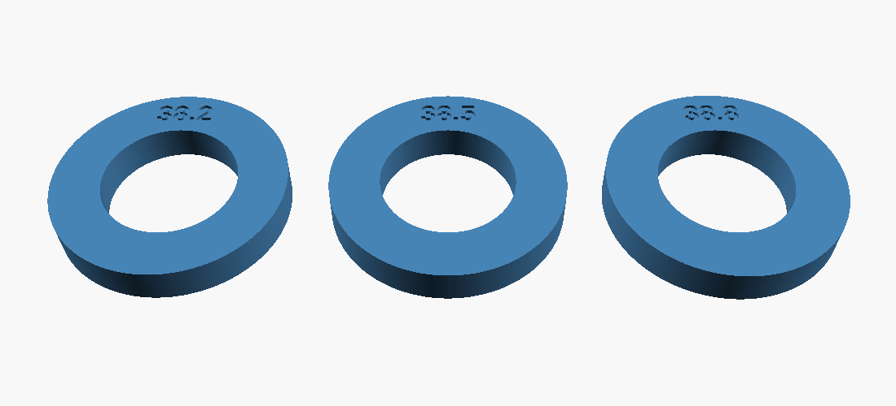

# Barrel fit-test rings

Three 6 mm-tall rings at 38.2, 38.5, and 38.8 mm, each with its size engraved on
top. Print them with the same PCTG and settings as the darts (including elephant's
foot compensation) and slide each into the barrel.

- Use the largest ring that slides freely with no wobble as the darts' `body_d`.
- Check both ends: printed side up and bed side up. The bed side has any
  first-layer flare, like a dart's tail ring.

About 18 g of filament for all three.
