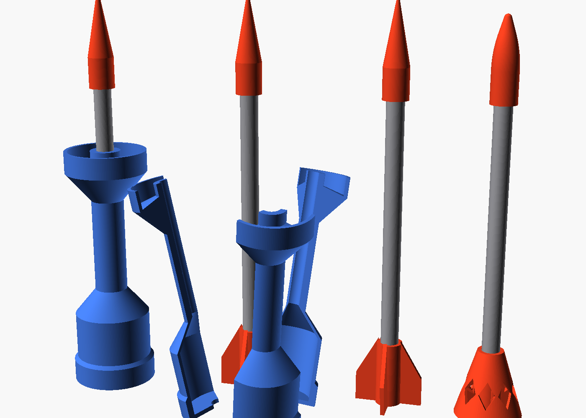
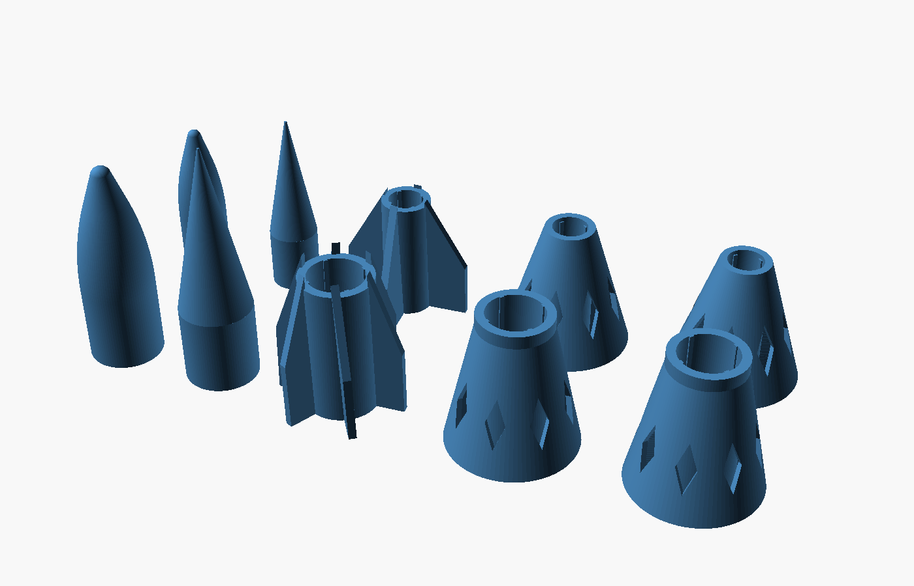

# Steel flechette and sabot

A store-bought **150 mm steel rod** with a printed nose and tail pushed on
(no glue), fired inside a three-petal printed sabot that falls away at the
muzzle. Every part comes in **two rod sizes** (Russ's rule):

| Folder | Rod | Rod weight | Role |
|---|---|---|---|
| `8mm/` | 8 mm hardened linear rod, or 5/16 in. Home Depot plain steel rod (7.94 mm, same parts) | 59 g | penetrator: fastest, flattest, deepest into wood |
| `12.7mm/` | 1/2 in. Home Depot plain steel rod (or a 1/2 in. linear shaft) | 149 g | heavy hitter: about 2.5x the mass, roughly twice the momentum at the same energy |

A metric 12 mm rod is too loose for the `12.7mm/` parts; use the `12mm/` set
for those. Build everything with `./build.sh`. Everything to print, per rod
size, plus the wad and a print sheet, is in `Flechette Print Packet.zip`.

Rod choice:
- Hardened linear rod: stays straight, holds a ground point; best for real targets.
- Home Depot plain (mild) steel: cheap, cut 150 mm (5.9 in.) pieces with a
  hacksaw and square/deburr the ends. Bends more easily on rocks or concrete;
  roll it on a flat table before shooting, and retire any that wobble.

| Part | File (in each folder) | 8 mm | 1/2 in. | Notes |
|---|---|---|---|---|
| Spike nose | `nose_spike.stl` | 3.3 g | 7.5 g | sleekest; chips on hard hits |
| Ogive nose (default) | `nose_ogive.stl` | 2.9 g | 6.2 g | bullet-shaped, rounded tip; rod reaches ~1/2 in. below the tip (8 mm) |
| Fin tail | `tail_fins.stl` | 3.9 g | 6.7 g | 30 mm span, 2 deg cant; 4 fins (8 mm), 6 longer fins (1/2 in.) |
| Basket tail | `tail_basket.stl` | 5.3 g | 7.3 g | flared windowed cone, no fins to snap |
| Spinning basket tail | `tail_basket_spin.stl` | 5.3 g | 7.3 g | inner vanes twisted 16 deg for gentle spin |
| Sabot petal (print 3) | `sabot_petal.stl` | 26.2 g | 25.3 g | rev 6: 39.6 mm (Russ's pick, the only size), full-width tail section, thick waist, 5 mm base |

Both noses have a tapered tail (Russ's idea) that runs 20 mm (8 mm) or 22 mm
(1/2 in.) back down the rod from the full-width sleeve, ending in a 1 mm wall.
No abrupt step from nose to rod: cleaner airflow, and the longer grip keeps
the nose straight. The taper section slides on; crush ribs are only in the
sleeve, so pressing on is no harder.

Finished flechette: about 66-68 g (8 mm) or 164-167 g (1/2 in.), 177-185 mm long.

Stability (Barrowman, rough; distance the center of pressure sits behind the CG):
- 8 mm: about 38 mm (fins) to 49 mm (basket). Very stable.
- 1/2 in.: about 12 mm with 6 fins, 28 mm with the basket. The heavy rod's
  fat hub weakens the fins and their span is capped by the sabot, which is
  why it gets 6 fins; 4 would be about neutral. **Use the basket tail on the
  1/2 in. rod** unless the fins prove themselves in testing.

Basket windows: the diamonds let air flow through the cone (less weight and
drag than a solid cone, like a shuttlecock); the pointed tops print without
supports. The bridges between windows are about 3.5-4 mm wide (8 mm) and
4.5-5 mm (1/2 in.).

**Fit (rev 2):** snug press fit, no glue, no crush ribs.
- Russ found the PCTG crush ribs don't crush (tails wouldn't go on), while the
  noses at +0.2 mm were a little loose.
- Each socket now has a plain round grip section modeled at exactly rod size
  (8.00 / 12.70 mm: Russ's fit gauge showed the +0.00 hole fits best, printed holes come out a bit over size)
  12-14 mm long, a looser bore elsewhere (rod + 0.25 mm), and tails have a
  chamfered mouth to start the rod straight.
- To dial it in, print `socket_fit_gauge.stl` from your rod-size folder: six
  holes from rod +0.00 to +0.25 mm, labeled. The hole that takes a firm push
  and then holds is the grip size; set `grip_fit` in `flechette_dims.scad`.

**Sabot:**
- Same outside for both rod sizes; the 1/2 in. version has a thicker waist
  and collar around the bigger rod and a deeper tail cavity for the longer fins.
- Two 38 mm touch points about 95 mm apart: the rear band, and the front band
  with its scoop.
- A hollow rear cavity holds the tail fins. The tail sits on the sabot's base, so
  air pushes base -> tail -> rod.
- At the muzzle, air fills the front ring scoop and pushes the three petals
  outward evenly.
- V-shaped alignment keys between the petals (a ridge on one face, a groove on the
  next) stop them sliding or twisting against each other but let them pull
  straight apart. For loading, hold the petals together by pinching the waist
  around the rod; once the first band is in the barrel, the barrel holds them. Fire with a wad behind it to seal the petal seams.

**Print:** supports off, 100% infill or 6+ walls.
- noses: tip up, with a brim (they stand on the narrow end of the taper)
- tails: base down
- petals: standing on their rear face

Every downward face is at least 50 deg; checked with tools/overhangs.py and tools/islands.py.

**Safety:** this is a real steel penetrator. Shoot it into a dirt berm or
hillside with nothing and nobody beyond the target.
