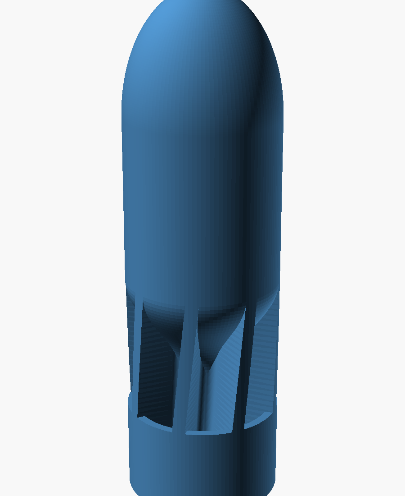

# Mk1 Ducted-Tail Dart

Claude's first from-scratch design. The goal is the strongest dart that still flies
nose-first, within the 38 mm limit, printed in PCTG with no metal.

| | Mk1 | Gemini Rev 15 (reference) |
|---|---|---|
| Length | 125 mm | 115 mm |
| Max diameter | 37.60 mm | 38.00 mm |
| Mass (solid PCTG) | ~107 g | ~93 g |
| CG from tip | 56.6 mm (45%) | 56.8 mm (49%) |
| Weakest layer, section modulus | **1570 mm³** | 733 mm³ |
| Stability margin (est., fins only) | +0.56 cal | +0.77 cal |
| Stability margin (est., incl. duct/ring) | +0.70 cal | ~+0.8 cal |

## How it works

- **Strength.** No skinny neck. The tail is a hollow 16 mm tube joined by 8 fins
  to a full-diameter duct ring, so every layer has a wide, well-spread cross-section.
  The weakest layer (Z ≈ 26 mm, just above the duct) resists bending about
  2.1x better than Rev 15's weakest layer.
- **Stability without metal.** The aft body is hollow (open at the base through
  the tail tube), so the solid nose and bearing band carry most of the mass and
  the CG sits forward. The cavity stops behind the CG; hollowing further forward
  moves the CG backward.
- **Fit in the barrel.** Two full-diameter (37.6 mm) bearing surfaces about 85 mm
  apart: the 40 mm band behind the nose and the duct ring at the base. The fin
  tips also reach full diameter between them.
- **Spin.** Fins are helical, about 6° at the tips. Ideal roll rate is about
  53 RPM per m/s of velocity (≈3,200 RPM at 60 m/s); expect less in practice.
- **Printing.** Nose-up, no supports. Overhangs are at least 50° from horizontal
  (the cavity roof) or close to vertical (the flare).

## Print settings (Bambu Studio)

- One uniform infill setting for the whole part: 100%, or high-density gyroid. No
  height-range modifiers that change density.
- 6+ walls.
- Hot nozzle (upper end of the PCTG range), low part-cooling fan, dry filament.
- A brim is a good idea. The part is tall and its footprint is a ring of fins.
- Check elephant's-foot compensation. The duct ring sits on the bed at 37.6 mm,
  and first-layer squish adds width.

## Caveats

- Stability numbers use the Barrowman method plus a rough duct term. They are
  good for comparing designs, not exact. The duct and spin should add stability
  beyond the fins-only figure, but test flights decide.
- Mass assumes 100% infill at 1.25 g/cm³. Weigh a print and update it.
- The core-rod idea was evaluated and left out. A printed rod that fits inside
  the tail tube would add only a few percent to the weakest layer's bending strength,
  not worth the pause-and-drop step.

## Files

- `mk1_dart.scad`: the parametric source; all key dimensions are at the top.
- `mk1_dart.stl`: ready to import into Bambu Studio.
- `previews/`: renders and true lengthwise cross-sections.

Regenerate: `tools/render.sh designs/mk1/mk1_dart.scad`, then
`tools/stability.py designs/mk1/mk1_dart.scad designs/mk1/mk1_dart.stl` and
`tools/strength.py designs/mk1/mk1_dart.stl`.
