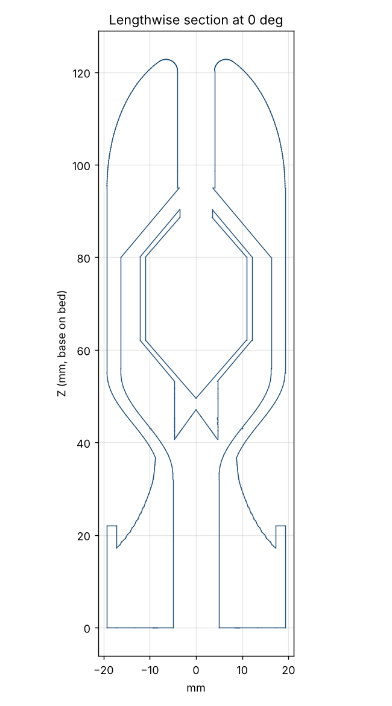

# Mk1-W Screaming Dart

> **Status: printed, and silent when blown.** The holes were based on a
> mis-measurement of the skull whistle (2.8 mm instead of ~6–7 mm). See
> `../whistle-tests/` for the test pieces that will decide the fix.

The Mk1 Ducted-Tail Dart with a death-whistle sound system inside, driven by air
rammed into the nose in flight. Same outside shape, fit, and print orientation as
Mk1.

## How it makes noise

It copies the layout of Russ's skull whistle (blown through the top hole, sound out
the back slits). The skull column below has the original, wrong hole sizes; see
`../whistle-tests/README.md` for corrected ones:

| Skull whistle | Mk1-W |
|---|---|
| You blow into a ~2.5–3 mm hole in the top | Air rams into a 5 mm funnel at the nose tip, narrowing to a 2.8 mm jet channel |
| ~6 mm gap, then the inner ball's top hole | ~7 mm gap from jet exit to the ball's 2.8 mm top hole |
| Hollow ball, ~32 mm, 1.2 mm shell | Hollow capsule with cone ends, 24.2 mm wide, 2.0 mm shell |
| ~4 mm gap around the ball | 3.5 mm gap around the ball |
| Exits: back slits (~120 mm²) and open bottom | Exits: 4 slots in the flare between fins (~110 mm²) and the open tail tube (~72 mm²) |

Rough resonance estimate (Helmholtz, ball volume and hole): ~560 Hz for the skull
whistle, ~640 Hz for Mk1-W, so a similar pitch. The death-whistle scream is largely
turbulent, broadband noise, so this is only a rough indicator.

Ram-air pressure at the nose is about 1.0 kPa at 40 m/s, 2.2 kPa at 60 m/s, and
3.9 kPa at 80 m/s. That should be in the range of hard human blowing, so it
should scream loudest right after launch and fade as it slows.

## Numbers vs Mk1

| | Mk1-W | Mk1 |
|---|---|---|
| Mass (100% PCTG) | ~91 g | ~107 g |
| CG from tip | 57.6 mm | 56.6 mm |
| CG off-axis | 0.000 mm | 0.000 mm |
| Stability margin (est., fins only / with duct) | +0.53 / +0.67 cal | +0.56 / +0.70 cal |
| Weakest layer, section modulus | 1559 mm³ (Z = 26 mm) | 1570 mm³ (Z = 26 mm) |
| Supports needed | None (steepest overhang 41.8°) | None (40.0°) |

## Symmetry

Everything is on the axis or repeated evenly around it: inlet, jet, ball, chamber,
4 gussets at 90°, and 4 outlet slots at 90° (centered between fins, following the
fin twist). The rendered STL's CG is on the axis to within 0.001 mm.

## Printing and use

- Same settings as Mk1: 100% infill, 6+ walls, supports off, brim, nose-up.
- The ball is held by four thin gussets underneath, angled so they print without
  supports.
- After landing, clear dirt out of the nose inlet (a paper clip works), and shake
  out anything that got into the tail.
- Some launch air will leak through the dart and out the nose (2.8 mm hole).
  The effect on launch should be negligible, and it may whistle in the barrel too.

## Unknowns to test

- Whether it actually screams, and at what speed it starts. If it's quiet, the
  first things to try are a larger inlet funnel, a different jet-to-ball gap
  (`jet_gap`), or a thinner ball shell.
- Stability is estimated, same caveats as Mk1.

Regenerate: `tools/render.sh designs/mk1w/mk1w_whistle_dart.scad`.
