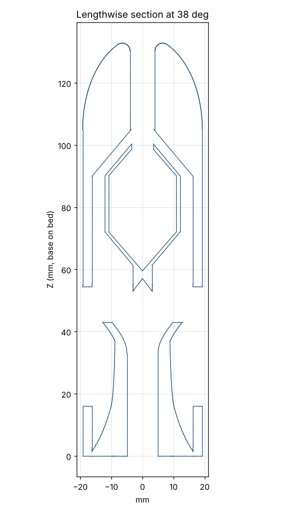

# Mk1-W Screaming Dart (Rev B)

The Mk1 Ducted-Tail Dart with a death-whistle sound system inside, driven by air
rammed into the nose in flight. Same outside shape, fit, and print orientation as
Mk1.

## History

- **Rev A** printed fine but was silent: its holes (2.8 mm) came from a
  mis-measurement of the skull whistle.
- **Whistle tests** (`../whistle-tests/`): A (skull copy) and D (dart-size with
  a 22 mm inlet channel) screamed like the skull. B and C (no channel) made sound
  but were too high-pitched.
- **Rev B** (this version) copies test piece D's internals. Later fixes: ball
  supports now meet the ball's tip (Bambu flagged a floating region), supports
  moved between the outlet slots, rounded nose mouth with no lip, 38.5 mm width,
  3 mm duct ring and 4.2 mm fins for glancing hits,
  body lengthened 10 mm and tail ring shortened to 16 mm to move the CG forward.

## How it makes noise

| | Test piece D (works) | Rev B |
|---|---|---|
| Inlet | 8 mm × 22 mm channel (you blow into it) | 8 mm × 22 mm channel from a rounded mouth at the nose tip (ram air) |
| Blow hole | 6 mm × 3 mm | 6 mm × 3 mm |
| Blow hole to ball hole | 5.4 mm | 5.4 mm |
| Ball | 24.2 mm cone-ended capsule, 1.2 mm shell, 7 mm hole | Same |
| Gap around ball | 3.5 mm | 4.1 mm (same ball, body now 38.5 mm) |
| Ball held by | Pedestal on the bed | Four 2.4 mm gussets under the ball |
| Exits | Open bottom | 8 slots between the fins (~220 mm²) + open tail tube (~80 mm²) |

Ram-air pressure at the nose is about 1.0 kPa at 40 m/s, 2.2 kPa at 60 m/s, and
3.9 kPa at 80 m/s, similar to hard blowing. Expect it loudest right after launch.

## Internal strength

On a nose-first impact the ball keeps moving forward and loads its gussets. The
ball shell weighs ~4 g. Stopping from 50 m/s in ~50 mm of dirt puts ~105 N on
the gussets; stopping in ~5 mm on hard ground puts ~1,050 N. That is about
6 MPa of shear in the gusset joints in the hard case, several times below PCTG's
strength. The load runs ball → gusset → wall along joints within each layer, so
it does not pull layers apart. The nose has no lip: the outside curves smoothly over into the inlet
(2.5 mm rounding), so there is no thin rim to chip.

## Numbers vs Mk1

| | Mk1-W Rev B | Mk1 |
|---|---|---|
| Max diameter | 38.50 mm | 38.50 mm |
| Length | 132.8 mm (rounded nose mouth) | 135 mm |
| Mass (100% PCTG) | ~101 g | ~131 g |
| CG from tip | 63.0 mm | 62.6 mm |
| CG off-axis | 0.000 mm | 0.000 mm |
| Stability margin (est., fins only / with duct) | +0.62 / +0.75 cal | +0.63 / +0.76 cal |
| Weakest layer, section modulus | 2018 mm³ (Z = 43 mm) | 2135 mm³ (Z = 37 mm) |
| Supports needed / floating regions | None / none | None / none |

## Printing and use

- Same settings as Mk1: 100% infill, 6+ walls, supports off, brim, nose-up.
- Test it before firing: blow into the nose. It should sound like test piece D.
- After landing, clear dirt out of the nose inlet and shake out the tail.

Regenerate: `tools/render.sh designs/mk1w/mk1w_whistle_dart.scad`.
