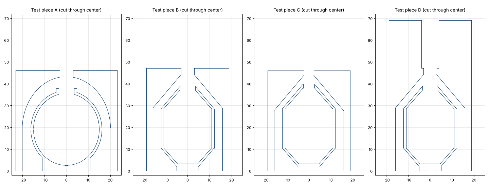

# Whistle test pieces

Mk1-W printed fine but made no sound when blown. Re-measuring Russ's skull
whistle at higher zoom showed the holes are much bigger than first measured:

| | Skull whistle (re-measured) | Mk1-W (silent) |
|---|---|---|
| Blow hole | ~6 mm, through a ~3 mm wall | 2.8 mm, 22 mm-long channel |
| Ball hole | ~7 mm, with a short raised rim | 2.8 mm, through a cone tip |
| Blow hole to ball hole | ~5.4 mm | ~7 mm |
| Ball shell | 1.2 mm | 2.0 mm |

These four short pieces isolate what makes it scream. Blow into the top hole of each
and note which make sound and how loud.

| Piece | What it tests | Width | Height |
|---|---|---|---|
| A | Skull copy: the skull's internals at full size in a plain cylinder. Baseline. | 46.3 mm | 46 mm |
| B | Dart-size (fits Mk1's body), skull hole sizes, short blow hole, cone-ended ball | 37.6 mm | 47 mm |
| C | B with holes and gap scaled down 25% to suit the smaller ball | 37.6 mm | 46 mm |
| D | B with a 22 mm × 8 mm inlet channel above the blow hole, like the dart's nose | 37.6 mm | 69 mm |

How to read the results:

- **A silent:** the copy misses something about how the skull works, so look harder
  at the skull before building more.
- **A screams, B silent:** the smaller ball, the cone shapes, or the different
  outlets matter.
- **B screams, C silent (or the reverse):** hole size matters more than proportion.
- **B screams, D silent:** the long nose channel kills it. The dart then needs a
  short inlet.
- **D screams:** that layout goes straight into the next dart.

Print upright as modeled (blow hole on top), 100% infill, no supports. B, C, and D
pass the overhang check. A copies the skull's round domes, so it has the same
gentle overhangs the skull has.

Regenerate one: `openscad -o whistle_test_B.stl -D 'variant="B"' whistle_test.scad`
